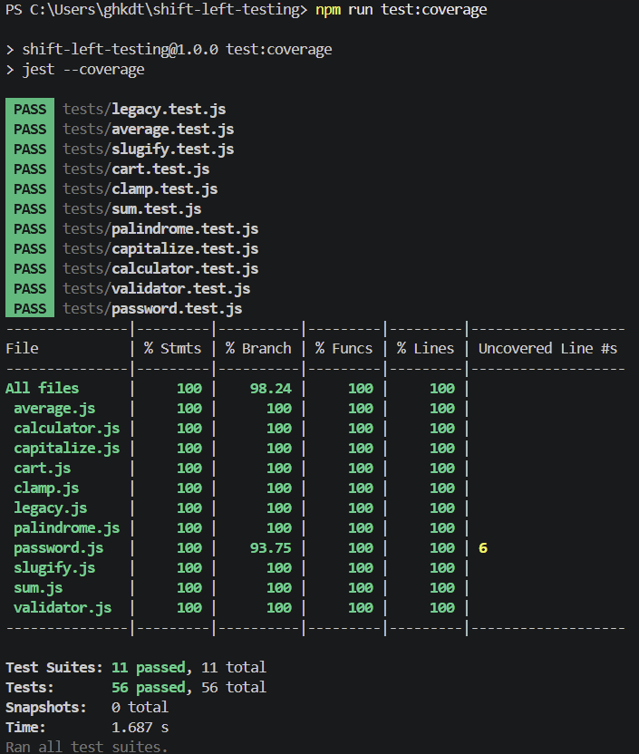
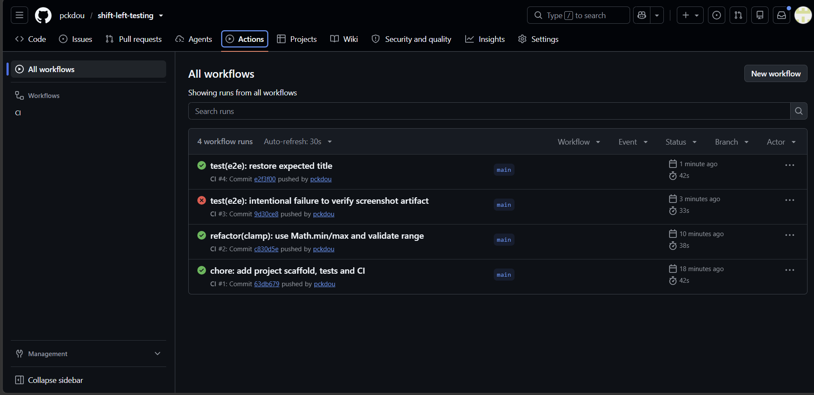
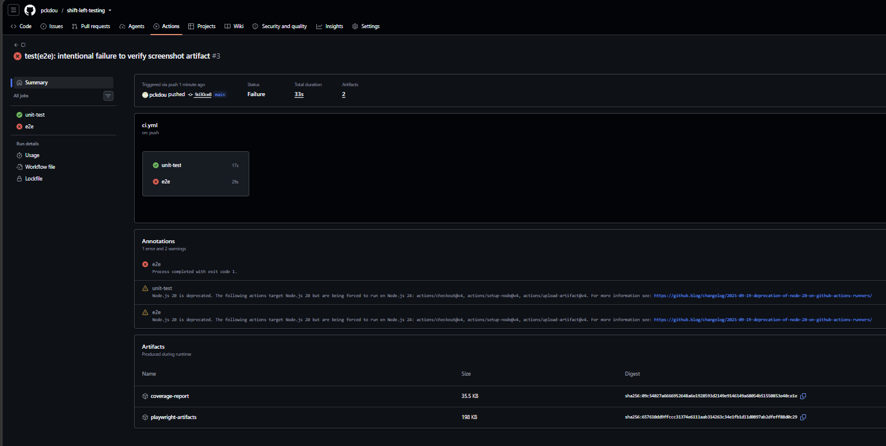

# Shift-Left Testing (12주차)


단위 테스트(Jest) 커버리지 80% 이상, GitHub Actions CI 자동 실행, TDD 사이클 적용, Playwright E2E 및 레거시 리팩토링 검증을 다룬 과제입니다.

## 1. 단위 테스트 & 커버리지

- 도구: Jest
- 결과: 테스트 56개 통과, Statements/Functions/Lines 100%, Branches 98.24%
- 기준: `jest.config.js`의 `coverageThreshold`로 80% 미만이면 CI 실패



## 2. TDD (Red-Green-Refactor) 핵심 기능 5개

| # | 기능 | 파일 | 커밋 흐름 |
|---|------|------|-----------|
| 1 | capitalize | src/capitalize.js | test → feat → refactor |
| 2 | isPalindrome | src/palindrome.js | test → feat → refactor |
| 3 | sum | src/sum.js | test → feat → refactor |
| 4 | average | src/average.js | test → feat → refactor |
| 5 | clamp | src/clamp.js | test → feat → refactor |

커밋 히스토리에서 `test(...)`(Red) → `feat(...)`(Green) → `refactor(...)` 순서를 확인할 수 있습니다.

## 3. CI (GitHub Actions)

- push / PR 시 `unit-test`, `e2e` job 자동 실행
- 커버리지 리포트를 아티팩트(`coverage-report`)로 저장



CI 결과: https://github.com/pckdou/shift-left-testing/actions

## 4. (선택) Playwright E2E

- 시나리오: example.com 접속 후 페이지 제목 확인
- 실패 시 스크린샷/트레이스를 `playwright-artifacts` 아티팩트로 저장
- 일부러 실패시켜 아티팩트 저장을 검증한 뒤 원복함



## 5. (선택) 레거시 코드 테스트 보강 후 리팩토링

1. `src/legacy.js`(중첩 if 구조)의 현재 동작을 고정하는 characterization test(`tests/legacy.test.js`) 작성
2. 테이블 + 함수 분리 방식으로 `calcShipping` 리팩토링
3. 테스트 수정 없이 전부 통과하여 리팩토링 안정성 검증

## 실행 방법

```bash
npm ci
npm test
npm run test:coverage
npx playwright install chromium
npm run test:e2e
```
